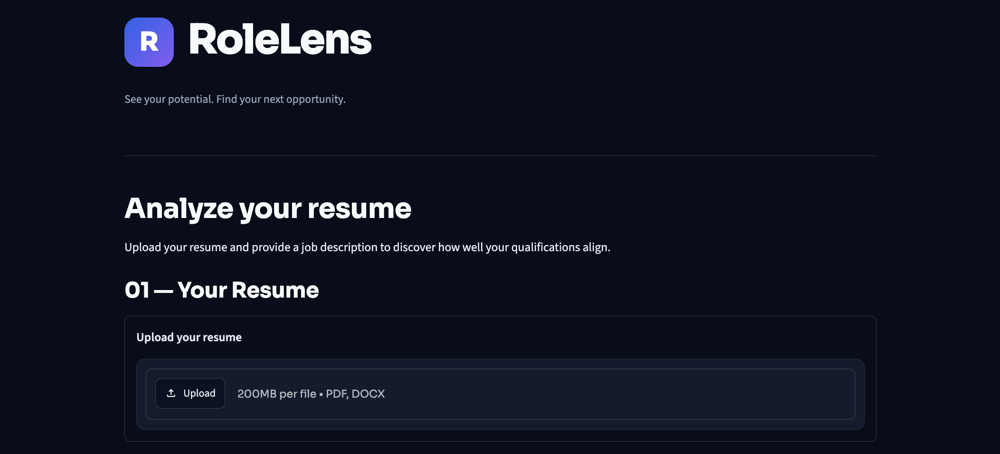
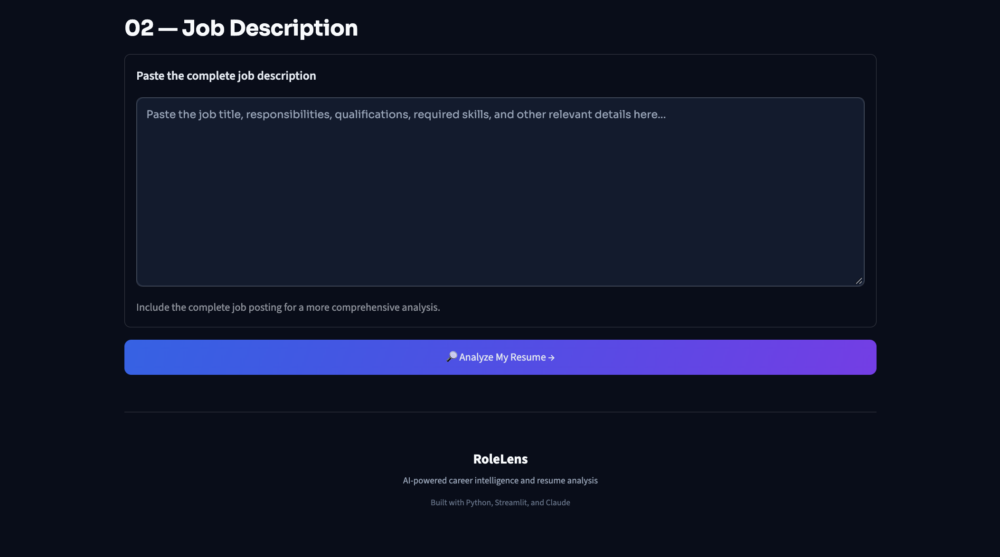
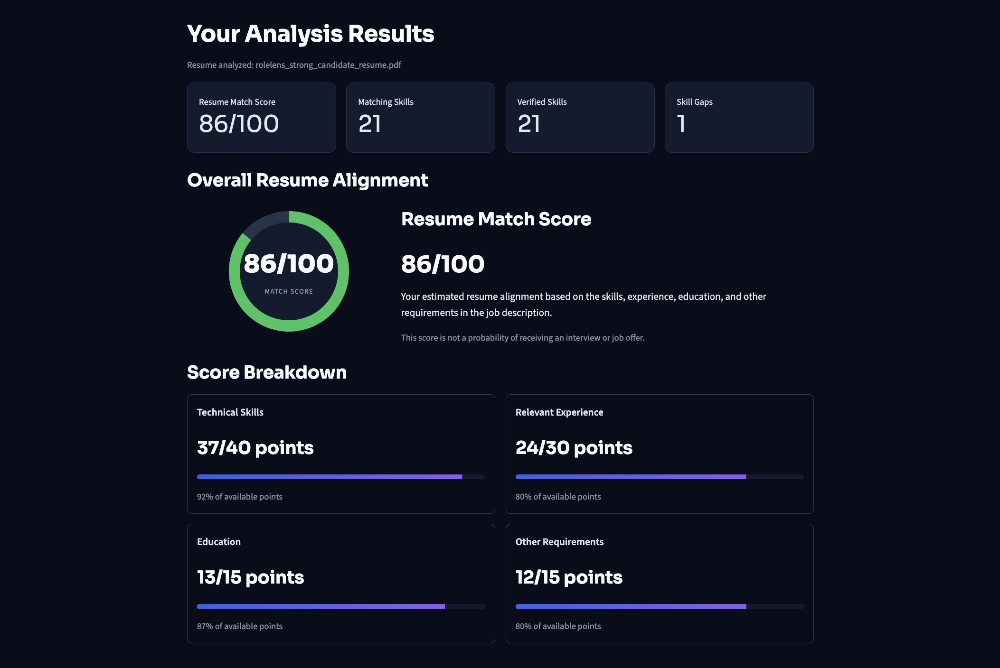
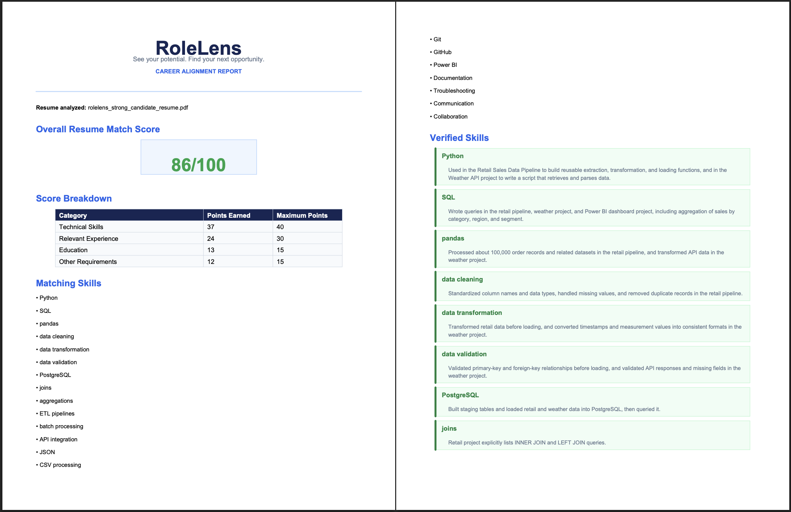

# RoleLens: AI-Powered Resume Analyzer

**See your potential. Find your next opportunity.**

RoleLens is an AI-powered resume analysis application that evaluates how well a candidate's resume aligns with a job description. Using Anthropic's Claude AI, Python, and Streamlit, the application identifies relevant skills, verifies qualifications through resume evidence, highlights missing requirements, and generates actionable recommendations to help candidates better understand their job fit.

## Application Screenshots

### Home Screen



### Resume Analysis Dashboard


### Generated PDF Report


## Features

- **Resume Parsing:** Upload PDF and DOCX resumes for automatic text extraction.
- **AI-Powered Analysis:** Analyze resumes against job descriptions using Anthropic's Claude API.
- **Resume Match Scoring:** Generate an overall match score based on four evaluation categories:
  - Technical Skills (40%)
  - Relevant Experience (30%)
  - Education (15%)
  - Other Requirements (15%)
- **Skill Verification:** Classify skills as verified, unverified, matching, or missing based on resume content and supporting evidence.
- **Experience Analysis:** Identify relevant experience, strengths, and areas for improvement.
- **Actionable Recommendations:** Generate suggestions to improve resume alignment with job requirements.
- **Interactive Dashboard:** View match scores, score breakdowns, and detailed analysis in an organized interface.
- **Report Generation:** Download analysis results as PDF and JSON files.
- **Usage Tracking:** Track anonymous visitor activity and enforce daily analysis limits using Supabase.
- **API Cost Protection:** Restrict usage to 2 analyses per visitor per day and 10 analyses across all visitors per day.

## Technologies Used

| Technology | Purpose |
|---|---|
| Python | Application logic and data processing |
| Streamlit | Interactive web interface |
| Anthropic Claude API | AI-powered resume analysis |
| Supabase | Database and daily usage tracking |
| PostgreSQL | Store and manage analysis usage records |
| pypdf | PDF text extraction |
| python-docx | DOCX text extraction |
| ReportLab | PDF report generation |
| python-dotenv | Environment variable management |
| pytest | Automated testing |

## Project Structure

```text
RoleLens/
├── .streamlit/
│   ├── config.toml
│   └── secrets.toml          # Local only; not committed
├── data/
│   └── sample_resumes/
├── prompts/
│   └── resume_analysis.txt
├── screenshots/
│   ├── home1.png
│   ├── home2.png
│   ├── dashboard.png
│   └── report.png
├── src/
│   ├── __init__.py
│   ├── branding.py
│   ├── claude_analyzer.py
│   ├── report_generator.py
│   ├── resume_parser.py
│   └── usage_limiter.py
├── supabase/
│   └── setup.sql
├── tests/
│   ├── test_analyzer.py
│   ├── test_resume_parser.py
│   └── test_skill_validation.py
├── .env.example
├── .gitignore
├── app.py
├── create_sample.py
├── requirements.txt
└── README.md
```

## Getting Started

### Prerequisites

- Python 3.10 or later
- Git
- An Anthropic API key
- A Supabase account and project

### 1. Clone the Repository

```bash
git clone https://github.com/Jessica-Makar/RoleLens.git
cd RoleLens
```

### 2. Create a Virtual Environment

```bash
python -m venv .venv
```

Activate the virtual environment:

**macOS / Linux**
```bash
source .venv/bin/activate
```

**Windows**
```bash
.venv\Scripts\activate
```

### 3. Install Dependencies

```bash
pip install -r requirements.txt
```

### 4. Configure Environment Variables

Create a `.env` file in the root directory using `.env.example` as a reference.

Add your Anthropic API key:

```env
ANTHROPIC_API_KEY=your_anthropic_api_key_here
```

### 5. Configure Supabase

RoleLens uses Supabase to track analysis usage and enforce daily limits.

1. Create a Supabase project.
2. Open the SQL Editor in your Supabase dashboard.
3. Open `supabase/setup.sql` from this repository.
4. Copy its contents into the Supabase SQL Editor and execute the script.
5. Configure your Supabase credentials in `.streamlit/secrets.toml`.

Create the following file:

```toml
[supabase]
url = "YOUR_SUPABASE_PROJECT_URL"
service_role_key = "YOUR_SUPABASE_SERVICE_ROLE_KEY"
```

Replace the placeholders with your Supabase project URL and service-role key.

**Security:** The service-role key must only be used by the server-side application. Never expose it in client-side code or commit it to GitHub.

### 6. Run the Application

```bash
python -m streamlit run app.py
```

The application will open in your browser.

## Usage Limits

To help protect API usage and control costs, RoleLens enforces two daily limits:

| Restriction | Daily Limit |
|---|---:|
| Analyses per visitor | 2 |
| Analyses across all visitors | 10 |

- Each visitor receives an anonymous UUID-based identifier stored in the browser's URL query parameters.
- Supabase records accepted analysis requests and tracks daily usage.
- Usage limits reset at midnight UTC.
- Visitors who reach their individual limit must wait until the next daily reset.
- The global limit prevents additional analyses once 10 requests have been accepted that day.

**Note:** Visitor identification is anonymous and browser-based, not account-based authentication. Clearing the visitor ID or using another browser can create a new visitor identity. The global daily limit provides an additional safeguard.

## Running Tests

Run the automated test suite from the project root:

```bash
python -m pytest -v
```

## How It Works

1. The user uploads a resume in PDF or DOCX format.
2. RoleLens extracts and cleans the resume text.
3. The user provides a job description.
4. The application identifies the visitor using an anonymous UUID.
5. Supabase checks the visitor's daily allowance and the application's global daily limit.
6. If usage is permitted, the application sends the resume content and job description to Claude for structured analysis.
7. The analysis is validated and used to calculate the overall match score.
8. Results are displayed in an interactive dashboard.
9. The user can download the analysis as a PDF or JSON report.
10. Supabase stores the accepted analysis usage record.

## Privacy and Security

- API credentials are stored in environment variables and Streamlit secrets and should never be committed to the repository.
- The Supabase service-role key is used exclusively by the server-side application.
- Row Level Security (RLS) is enabled on the analysis usage table.
- Resume content is processed through the Anthropic API for analysis.
- Anonymous visitor identifiers are used for usage tracking; users do not need to create accounts.
- Users should avoid uploading sensitive personal information unless they understand and accept the applicable data-handling practices.

## Future Improvements

Potential enhancements include:
- Resume improvement and rewriting assistance.
- Comparison of multiple resumes against one job description.
- More detailed job-specific skill recommendations.
- Additional analysis and reporting options.
- Deployment to a public hosting platform.

## Disclaimer

RoleLens provides AI-generated resume feedback for informational purposes. Match scores and recommendations are estimates and should not be treated as guarantees of employment or hiring decisions.

## Author

**Jessica Makar**

Computer Science & Data Science Graduate | Rutgers University

[GitHub](https://github.com/Jessica-Makar)
